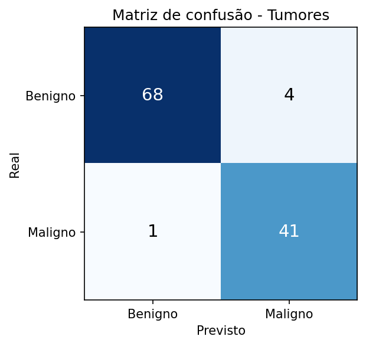
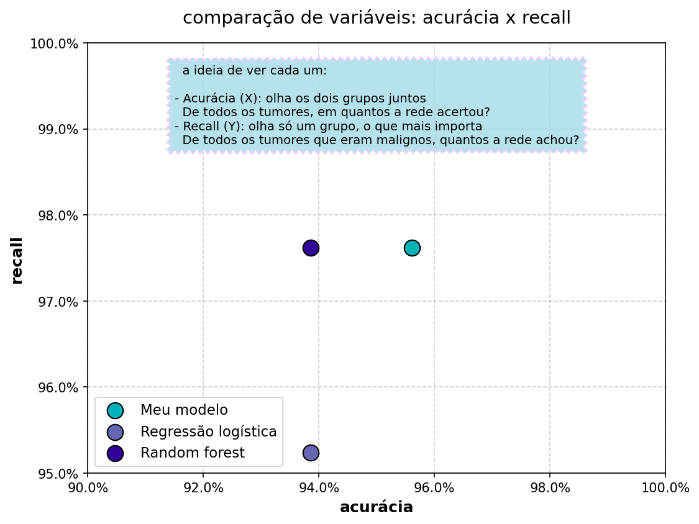

# Rede neural do zero para classificar tumores

Classificador binário (benigno × maligno) feito **só com NumPy**: propagação, função de perda, backpropagation e gradiente descendente escritos à mão, sem TensorFlow nem PyTorch. Acerta **95,6% no teste**, contra 63,2% de um baseline ingênuo, e detecta **41 dos 42 tumores malignos** do conjunto de teste. Também comparei com a regressão logística e o random forest do scikit-learn, e a rede feita à mão ficou no mesmo nível.

Projeto de estudo da minha trilha de IA. A ideia era entender o que acontece dentro de uma rede antes de usar uma biblioteca que esconde tudo isso.

## Resultados

| Métrica | Valor |
|---|---|
| Acurácia no teste | 95,6% |
| Acurácia no treino | 95,6% |
| Baseline (sempre prever a classe mais comum) | 63,2% |
| Ganho sobre o baseline | +32,5 pontos |
| Recall dos malignos | 97,6% (41 de 42) |
| Perda final (entropia cruzada) | 0,102 |


### Matriz de confusão (114 tumores de teste)



No teste, a rede detectou 41 dos 42 tumores malignos e deixou 1 passar como benigno. Também marcou 4 tumores benignos como malignos, um erro menos grave. O baseline, que sempre prevê benigno, tem recall de 0%.

## Comparação com modelos de referência

Mesmas 4 características, mesma padronização e mesma divisão treino/teste (114 amostras de teste):

| Modelo | Acurácia | Recall dos malignos |
|---|---|---|
| Baseline (sempre benigno) | 63,2% | 0% |
| Minha rede do zero | 95,6% | 97,6% (41 de 42) |
| Regressão logística (scikit-learn) | 93,9% | 95,2% (40 de 42) |
| Random forest (scikit-learn) | 93,9% | 97,6% (41 de 42) |



A diferença entre os três modelos é de 1 a 2 amostras do teste, então não dá para dizer que um é melhor que o outro. O que a comparação mostra é que a rede feita à mão chega ao nível dos modelos prontos, o que indica que a implementação está correta. Num dataset pequeno e tabular como este, um modelo simples já resolve bem.

## Dados

- **Fonte:** Breast Cancer Wisconsin (Diagnostic), de Wolberg, Street e Mangasarian, no [UCI Machine Learning Repository](https://doi.org/10.24432/C5DW2B) (doi 10.24432/C5DW2B).
- **O que é:** medidas extraídas de imagens de células de 569 tumores de mama. Usei a cópia que acompanha o scikit-learn, sem alterar os valores.
- **O que usei dele:**
  - 4 características (de 30): `raio_medio`, `textura_media`, `suavidade_media`, `pontos_concavos_medio`
  - Rótulo `B_maligno` (0 = benigno, 1 = maligno)
  - Divisão em 455 amostras de treino e 114 de teste (coluna `conjunto`)
- **Uso:** exercício de estudo, não de diagnóstico.

## Como funciona

**Pré-processamento.** Cada característica é padronizada (média 0, desvio 1) usando apenas a média e o desvio do treino. O teste e os dados novos recebem os mesmos valores, para não vazar informação.

**Baseline.** Antes de treinar, medi quanto um "modelo" que sempre prevê a classe mais frequente acerta. Uma rede só tem valor se superar esse número.

**Arquitetura.**

```
4 entradas → 32 neurônios (ReLU) → 1 neurônio (sigmoide) → probabilidade de ser maligno
```

**Treino.**

- Inicialização He nos pesos da camada escondida e semente fixa (`np.random.seed(42)`) para resultados reproduzíveis
- Perda: entropia cruzada binária, com `clip` para evitar `log(0)`
- Gradientes calculados à mão, da saída para a entrada (backpropagation)
- Gradiente descendente, taxa de aprendizado 0,1, 10000 passos

**Avaliação.** Acurácia, matriz de confusão e recall dos malignos, porque deixar um tumor maligno passar é o erro mais grave.

**Previsão com dados novos.** O notebook tem campos para digitar os 4 valores de um tumor e um botão que devolve a probabilidade de ser maligno e a previsão da rede. Os campos só funcionam ao rodar o notebook (Colab ou Jupyter), não na visualização do GitHub.

## Salvar e carregar o modelo

Depois do treino, os parâmetros e a padronização são salvos em `modelo_tumores.npz`, para prever sem treinar de novo:

| Array | Formato | O que é |
|---|---|---|
| `pesos_escondida` | (4, 32) | pesos das 4 entradas para os 32 neurônios |
| `vies_escondida` | (1, 32) | 1 viés por neurônio escondido |
| `pesos_saida` | (32, 1) | pesos dos 32 neurônios para a saída |
| `vies_saida` | (1, 1) | viés da saída |
| `media`, `desvio` | (4,) | padronização, calculada só com o treino |
| `colunas` | (4,) | nomes das colunas, na ordem em que a rede espera |

```python
import numpy as np

modelo = np.load("modelo_tumores.npz")
print(modelo.files)
```

Para prever, o tumor novo precisa ser padronizado com `media` e `desvio` do arquivo e passar pelas mesmas contas da propagação (soma, ReLU, soma, sigmoide), com as 4 medidas na ordem de `colunas`.

## O que eu aprendi

- Como o gradiente atravessa as camadas e por que a derivada da ReLU vira uma máscara (`soma > 0`)
- Por que o erro da saída fica simples (`probabilidade - resposta`) quando se combina sigmoide com entropia cruzada
- Por que o pré-processamento deve usar só estatísticas do treino
- Por que comparar com um baseline antes de comemorar a acurácia
- Por que acurácia sozinha engana e o recall mostra o erro que mais importa
- Que o formato da saída importa: uma rede binária precisa de 1 neurônio de saída. Com 5, as contagens da matriz de confusão saíram multiplicadas por 5 sem nenhum erro aparecer, e só a soma da matriz (570 em vez de 114) mostrou o problema
- Como pesos e vieses são guardados (matrizes e vetores) e como salvá-los com `np.savez`
- Como comparar com modelos prontos de forma justa (mesmas entradas e mesma divisão) e como interpretar diferenças de 1 ou 2 amostras

## Limitações

- Dataset pequeno e dividido uma única vez, com uma única semente, então o resultado tem variação
- Com 114 amostras de teste, 1 ou 2 erros nos malignos já mexem bastante no recall, e diferenças de 1 a 2 amostras entre modelos não são conclusivas
- Só há treino e teste, sem conjunto de validação separado. Por isso o resultado no teste é uma estimativa, e escolhas como o número de neurônios não foram validadas à parte
- A perda ainda caía devagar ao fim dos 10000 passos
- O modelo salvo só vale para essas 4 medidas, na mesma ordem e na mesma escala do treino
- Projeto educacional, **não serve para diagnóstico**


## Como rodar

```bash
pip install numpy pandas matplotlib scikit-learn jupyter ipywidgets
jupyter notebook treino_redeneural_ia.ipynb
```

Deixe o `tumores.csv` na mesma pasta do notebook e rode as células de cima para baixo.

## Autora

**Marianna Holanda**, estudante de Engenharia da Computação na UNIFOR e estagiária de IoT no Vortex Lab. Tenho interesse em visão computacional e desenvolvimento de software, e também em firmware, IoT e Edge AI.

[GitHub](https://github.com/mmariannaholanda)
