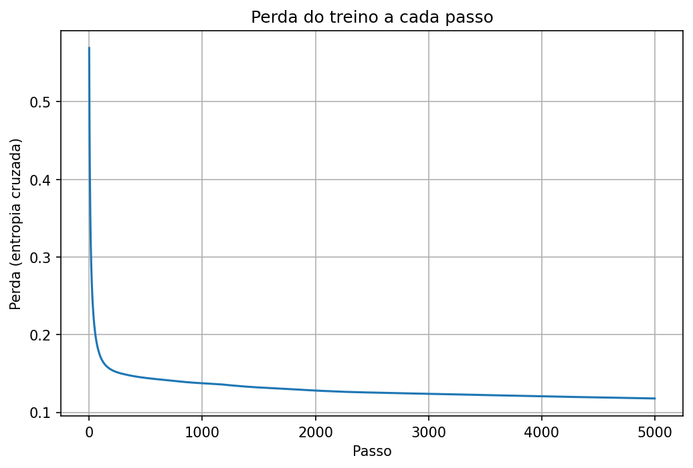

# Rede neural do zero para classificar tumores

Classificador binário (benigno × maligno) feito **só com NumPy**: propagação, função de perda, backpropagation e gradiente descendente escritos à mão, sem TensorFlow nem PyTorch. Acerta **95,6% no teste**, contra 63,2% de um baseline ingênuo.

Projeto de estudo da minha trilha de IA. A ideia era entender o que acontece dentro de uma rede antes de usar uma biblioteca que esconde tudo isso.

## Resultados

| Métrica | Valor |
|---|---|
| Acurácia no teste | 95,6% |
| Acurácia no treino | 95,2% |
| Baseline (sempre prever a classe mais comum) | 63,2% |
| Ganho sobre o baseline | +32,5 pontos |
| Perda final (entropia cruzada) | 0,118 |

Treino e teste com acurácias próximas indicam que a rede não decorou os dados (sem overfitting relevante).



## Dados

- **Fonte:** Breast Cancer Wisconsin (Diagnostic), de Wolberg, Street e Mangasarian, no [UCI Machine Learning Repository](https://doi.org/10.24432/C5DW2B) (doi 10.24432/C5DW2B).
- **O que é:** medidas extraídas de imagens de células de 569 tumores de mama. Usei a cópia que acompanha o scikit-learn, sem alterar os valores.
- **O que usei dele:**
  - 4 características (de 30): `raio_medio`, `textura_media`, `suavidade_media`, `pontos_concavos_medio`
  - Rótulo `B_maligno` (0 = benigno, 1 = maligno)
  - Divisão em 455 amostras de treino e 114 de teste (coluna `conjunto`)
- **Uso:** exercício de estudo, não de diagnóstico.

## Como funciona

**Pré-processamento.** Cada característica é padronizada (média 0, desvio 1) usando apenas a média e o desvio do treino. O teste recebe os mesmos valores, para não vazar informação dos dados que a rede não pode ver.

**Baseline.** Antes de treinar, medi quanto um "modelo" que sempre prevê a classe mais frequente acerta. Uma rede só tem valor se superar esse número.

**Arquitetura.**

```
4 entradas → 8 neurônios (ReLU) → 1 neurônio (sigmoide) → probabilidade de ser maligno
```

**Treino.**

- Inicialização He nos pesos da camada escondida
- Perda: entropia cruzada binária, com `clip` para evitar `log(0)`
- Gradientes calculados à mão, da saída para a entrada (backpropagation)
- Gradiente descendente, taxa de aprendizado 0,1, 5000 passos

## O que eu aprendi

- Como o gradiente atravessa as camadas e por que a derivada da ReLU vira uma máscara (`soma > 0`)
- Por que o erro da saída fica simples (`probabilidade - resposta`) quando se combina sigmoide com entropia cruzada
- Por que o pré-processamento deve usar só estatísticas do treino
- Por que comparar com um baseline antes de comemorar a acurácia

## Limitações

- Dataset pequeno e dividido uma única vez, então o resultado tem variação
- Sem semente fixa nesta versão, então os números mudam um pouco a cada execução
- Acurácia sozinha não mostra quantos tumores malignos passaram como benignos (falsos negativos)
- Projeto educacional, **não serve para diagnóstico**

## Próximos passos

- [ ] Fixar a semente aleatória
- [ ] Matriz de confusão e recall dos casos malignos
- [ ] Comparar com um modelo de referência da scikit-learn
- [ ] Levar a ideia para Edge AI: rodar um modelo pequeno em microcontrolador (ESP32)

## Como rodar

```bash
pip install numpy pandas matplotlib scikit-learn jupyter
jupyter notebook treino_redeneural_ia.ipynb
```

Deixe o `tumores.csv` na mesma pasta do notebook.

## Autora

**Marianna Figueiredo Holanda**, estudante de Engenharia da Computação na UNIFOR e estagiária de IoT no Vortex Lab. Foco em firmware, IoT, IA  e desenvolvimento de software.

[GitHub](https://github.com/mmariannaholanda)
